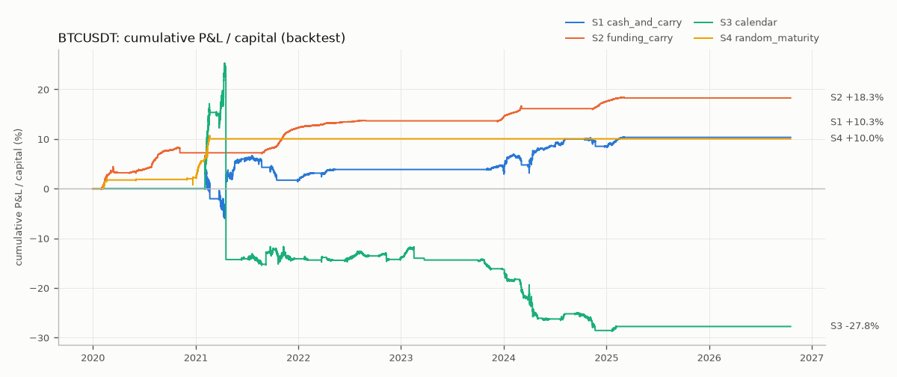
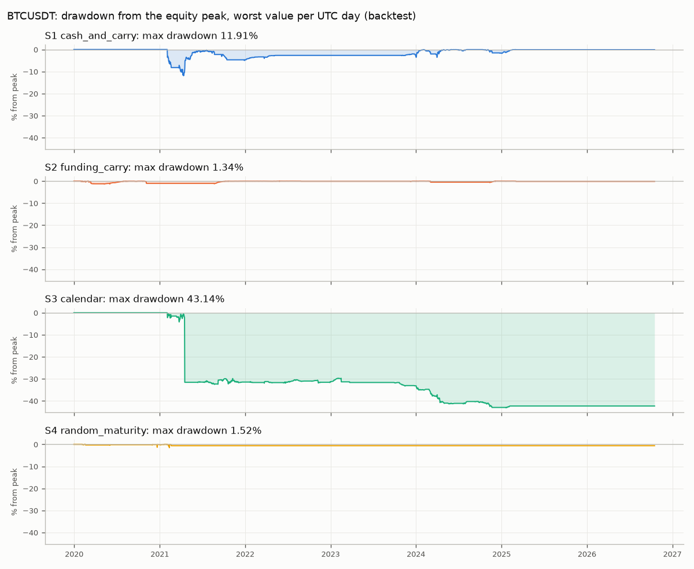
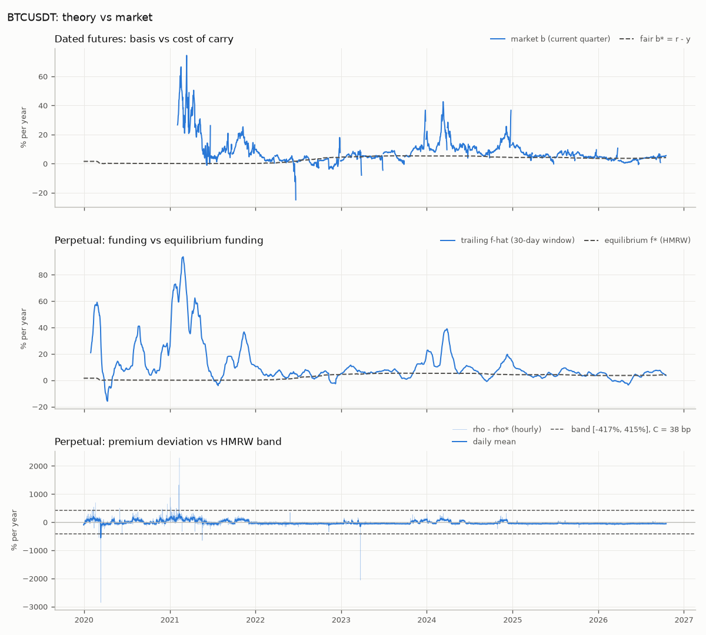

# Backtest report: BTCUSDT

Backtest (simulated taker fills on historical hourly bars), not paper or live results.
Sample 2020-01-01T00:00:00+00:00 to 2026-10-17T20:00:00+00:00 (59,565 hourly bars, 6.80 years), panel `data\panel_BTCUSDT_1h.parquet`.
Capital unit: 10,000 USDT per leg, equal coin quantity on both legs. All figures are net of fees, slippage, delivery fees and liquidation penalties.

## Headline

| Strategy | Ann. return on capital | Sharpe | Max DD | Round trips | Hit rate | Avg hold (h) | Time in position | Turnover (x/yr) | Worst 30d | Liquidations |
| --- | ---: | ---: | ---: | ---: | ---: | ---: | ---: | ---: | ---: | ---: |
| S1 cash_and_carry | 1.52% | 0.40 | 11.91% | 14 | 71% | 1,092 | 26% | 6.1 | -6.52% | 5 |
| S2 funding_carry | 2.69% | 3.87 | 1.34% | 5 | 100% | 3,872 | 33% | 2.0 | -1.07% | 2 |
| S3 calendar | -4.08% | -0.27 | 43.14% | 36 | 53% | 448 | 27% | 22.3 | -39.51% | 4 |
| S4 random_maturity | 1.48% | 2.22 | 1.52% | 8 | 100% | 150 | 2% | 3.2 | -0.49% | 1 |

Ann. return = total P&L / capital / years. Worst 30d = worst rolling 30-day P&L / capital. Turnover = traded notional / capital per year. Round trips exclude a position still open on the last bar.

## P&L decomposition (USDT, whole sample)

| Strategy | Capital | Basis convergence | Funding | Fees + slippage | Delivery fees | Liquidation penalties | Total |
| --- | ---: | ---: | ---: | ---: | ---: | ---: | ---: |
| S1 cash_and_carry | 15,000 | 2,535.87 | 0.00 | -582.91 | 0.00 | -404.10 | 1,548.85 |
| S2 funding_carry | 15,000 | 34.55 | 3,044.42 | -189.90 | 0.00 | -149.71 | 2,739.36 |
| S3 calendar | 10,000 | -2,587.93 | 1,125.60 | -1,060.72 | 0.00 | -253.47 | -2,776.52 |
| S4 random_maturity | 15,000 | 420.46 | 1,473.61 | -313.48 | 0.00 | -75.11 | 1,505.48 |

## Margin

| Strategy | Margin mode | Leverage | Peak utilization | Bars above isolated threshold | Liquidations |
| --- | ---: | ---: | ---: | ---: | ---: |
| S1 cash_and_carry | isolated | fut 2x | 1.051 | 5 | 5 |
| S2 funding_carry | isolated | perp 2x | 1.016 | 2 | 2 |
| S3 calendar | isolated | perp 2x, fut 2x | 1.017 | 4 | 4 |
| S4 random_maturity | isolated | perp 2x | 1.029 | 1 | 1 |

## Year by year

Bars are labeled by close time, so the bar closing at 00:00 UTC on 1 January belongs to the previous year (a sample starting at 00:00 shows a one-bar row for that year). Round trips are counted in the year they close; costs = fees + slippage + delivery fees + liquidation penalties.

### S1 cash_and_carry

| Year | Days | P&L (USDT) | Return | Sharpe | Max DD | Basis | Funding | Costs | Round trips | Time in position | Liquidations |
| --- | ---: | ---: | ---: | ---: | ---: | ---: | ---: | ---: | ---: | ---: | ---: |
| 2019 | 1 | 0.00 | 0.00% | n/a | 0.00% | 0.00 | 0.00 | 0.00 | 0 | 0% | 0 |
| 2020 | 366 | 0.00 | 0.00% | n/a | 0.00% | 0.00 | 0.00 | 0.00 | 0 | 0% | 0 |
| 2021 | 365 | 274.14 | 1.83% | 0.20 | 11.91% | 816.02 | 0.00 | -541.88 | 7 | 49% | 3 |
| 2022 | 365 | 304.48 | 2.03% | 2.10 | 0.77% | 351.25 | 0.00 | -46.77 | 2 | 28% | 0 |
| 2023 | 365 | -11.84 | -0.08% | -0.11 | 1.11% | 24.52 | 0.00 | -36.36 | 0 | 16% | 0 |
| 2024 | 366 | 707.13 | 4.71% | 1.26 | 3.57% | 1,051.61 | 0.00 | -344.49 | 4 | 63% | 2 |
| 2025 | 365 | 274.95 | 1.83% | 3.06 | 0.49% | 292.47 | 0.00 | -17.52 | 1 | 18% | 0 |
| 2026 | 290 | 0.00 | 0.00% | n/a | 0.00% | 0.00 | 0.00 | 0.00 | 0 | 0% | 0 |

### S2 funding_carry

| Year | Days | P&L (USDT) | Return | Sharpe | Max DD | Basis | Funding | Costs | Round trips | Time in position | Liquidations |
| --- | ---: | ---: | ---: | ---: | ---: | ---: | ---: | ---: | ---: | ---: | ---: |
| 2019 | 1 | 0.00 | 0.00% | n/a | 0.00% | 0.00 | 0.00 | 0.00 | 0 | 0% | 0 |
| 2020 | 366 | 1,083.18 | 7.22% | 4.85 | 1.34% | -1.87 | 1,239.03 | -153.98 | 2 | 65% | 1 |
| 2021 | 365 | 756.92 | 5.05% | 8.62 | 0.15% | 4.83 | 771.09 | -19.00 | 0 | 36% | 0 |
| 2022 | 365 | 207.88 | 1.39% | 5.66 | 0.13% | 0.35 | 215.08 | -7.55 | 1 | 66% | 0 |
| 2023 | 365 | 121.29 | 0.81% | 3.49 | 0.11% | 2.25 | 138.04 | -19.01 | 0 | 6% | 0 |
| 2024 | 366 | 467.27 | 3.12% | 4.57 | 0.64% | 29.00 | 560.58 | -122.31 | 1 | 31% | 1 |
| 2025 | 365 | 102.83 | 0.69% | 3.78 | 0.13% | -0.01 | 120.60 | -17.76 | 1 | 17% | 0 |
| 2026 | 290 | 0.00 | 0.00% | n/a | 0.00% | 0.00 | 0.00 | 0.00 | 0 | 0% | 0 |

### S3 calendar

| Year | Days | P&L (USDT) | Return | Sharpe | Max DD | Basis | Funding | Costs | Round trips | Time in position | Liquidations |
| --- | ---: | ---: | ---: | ---: | ---: | ---: | ---: | ---: | ---: | ---: | ---: |
| 2019 | 1 | 0.00 | 0.00% | n/a | 0.00% | 0.00 | 0.00 | 0.00 | 0 | 0% | 0 |
| 2020 | 366 | 0.00 | 0.00% | n/a | 0.00% | 0.00 | 0.00 | 0.00 | 0 | 0% | 0 |
| 2021 | 365 | -1,412.96 | -14.13% | -0.37 | 32.53% | -2,149.48 | 1,302.67 | -566.15 | 16 | 53% | 2 |
| 2022 | 365 | 21.39 | 0.21% | 0.13 | 2.30% | 148.12 | 111.56 | -238.29 | 8 | 43% | 0 |
| 2023 | 365 | -235.56 | -2.36% | -0.92 | 5.25% | -74.09 | 22.53 | -184.01 | 4 | 26% | 1 |
| 2024 | 366 | -1,230.05 | -12.30% | -2.49 | 14.69% | -652.75 | -278.30 | -298.99 | 7 | 58% | 1 |
| 2025 | 365 | 80.67 | 0.81% | 1.93 | 0.56% | 140.27 | -32.85 | -26.75 | 1 | 4% | 0 |
| 2026 | 290 | 0.00 | 0.00% | n/a | 0.00% | 0.00 | 0.00 | 0.00 | 0 | 0% | 0 |

### S4 random_maturity

| Year | Days | P&L (USDT) | Return | Sharpe | Max DD | Basis | Funding | Costs | Round trips | Time in position | Liquidations |
| --- | ---: | ---: | ---: | ---: | ---: | ---: | ---: | ---: | ---: | ---: | ---: |
| 2019 | 1 | 0.00 | 0.00% | n/a | 0.00% | 0.00 | 0.00 | 0.00 | 0 | 0% | 0 |
| 2020 | 366 | 331.11 | 2.21% | 3.21 | 1.32% | 273.67 | 246.08 | -188.65 | 5 | 4% | 0 |
| 2021 | 365 | 1,174.38 | 7.83% | 5.07 | 1.52% | 146.79 | 1,227.53 | -199.94 | 3 | 10% | 1 |
| 2022 | 365 | 0.00 | 0.00% | n/a | 0.00% | 0.00 | 0.00 | 0.00 | 0 | 0% | 0 |
| 2023 | 365 | 0.00 | 0.00% | n/a | 0.00% | 0.00 | 0.00 | 0.00 | 0 | 0% | 0 |
| 2024 | 366 | 0.00 | 0.00% | n/a | 0.00% | 0.00 | 0.00 | 0.00 | 0 | 0% | 0 |
| 2025 | 365 | 0.00 | 0.00% | n/a | 0.00% | 0.00 | 0.00 | 0.00 | 0 | 0% | 0 |
| 2026 | 290 | 0.00 | 0.00% | n/a | 0.00% | 0.00 | 0.00 | 0.00 | 0 | 0% | 0 |

## Stress episodes

### S1 cash_and_carry

| Episode | Window (UTC days) | Coverage | P&L (USDT) | Return | Max DD | Basis | Funding | Costs | Time in position | Liquidations |
| --- | ---: | ---: | ---: | ---: | ---: | ---: | ---: | ---: | ---: | ---: |
| Mar-2020 | 2020-03-01 .. 2020-04-30 | 100% | 0.00 | 0.00% | 0.00% | 0.00 | 0.00 | 0.00 | 0% | 0 |
| May-2021 | 2021-05-01 .. 2021-08-15 | 100% | 505.27 | 3.37% | 1.62% | 611.03 | 0.00 | -105.77 | 86% | 0 |
| Nov-2022 FTX | 2022-11-01 .. 2022-12-31 | 100% | 0.00 | 0.00% | 0.00% | 0.00 | 0.00 | 0.00 | 0% | 0 |
| Aug-2024 | 2024-08-01 .. 2024-09-30 | 100% | 99.77 | 0.67% | 0.15% | 115.76 | 0.00 | -15.99 | 7% | 0 |
| Q1/Q2-2026 funding compression | 2026-01-31 .. 2026-05-31 | 100% | 0.00 | 0.00% | 0.00% | 0.00 | 0.00 | 0.00 | 0% | 0 |

### S2 funding_carry

| Episode | Window (UTC days) | Coverage | P&L (USDT) | Return | Max DD | Basis | Funding | Costs | Time in position | Liquidations |
| --- | ---: | ---: | ---: | ---: | ---: | ---: | ---: | ---: | ---: | ---: |
| Mar-2020 | 2020-03-01 .. 2020-04-30 | 100% | 9.99 | 0.07% | 1.23% | 14.55 | 8.14 | -12.70 | 44% | 0 |
| May-2021 | 2021-05-01 .. 2021-08-15 | 100% | 0.00 | 0.00% | 0.00% | 0.00 | 0.00 | 0.00 | 0% | 0 |
| Nov-2022 FTX | 2022-11-01 .. 2022-12-31 | 100% | 0.00 | 0.00% | 0.00% | 0.00 | 0.00 | 0.00 | 0% | 0 |
| Aug-2024 | 2024-08-01 .. 2024-09-30 | 100% | 0.00 | 0.00% | 0.00% | 0.00 | 0.00 | 0.00 | 0% | 0 |
| Q1/Q2-2026 funding compression | 2026-01-31 .. 2026-05-31 | 100% | 0.00 | 0.00% | 0.00% | 0.00 | 0.00 | 0.00 | 0% | 0 |

### S3 calendar

| Episode | Window (UTC days) | Coverage | P&L (USDT) | Return | Max DD | Basis | Funding | Costs | Time in position | Liquidations |
| --- | ---: | ---: | ---: | ---: | ---: | ---: | ---: | ---: | ---: | ---: |
| Mar-2020 | 2020-03-01 .. 2020-04-30 | 100% | 0.00 | 0.00% | 0.00% | 0.00 | 0.00 | 0.00 | 0% | 0 |
| May-2021 | 2021-05-01 .. 2021-08-15 | 100% | -53.65 | -0.54% | 2.32% | 86.62 | -41.35 | -98.92 | 40% | 0 |
| Nov-2022 FTX | 2022-11-01 .. 2022-12-31 | 100% | -68.66 | -0.69% | 1.99% | -28.07 | -13.95 | -26.64 | 34% | 0 |
| Aug-2024 | 2024-08-01 .. 2024-09-30 | 100% | 48.14 | 0.48% | 0.99% | 133.18 | -29.67 | -55.37 | 41% | 0 |
| Q1/Q2-2026 funding compression | 2026-01-31 .. 2026-05-31 | 100% | 0.00 | 0.00% | 0.00% | 0.00 | 0.00 | 0.00 | 0% | 0 |

### S4 random_maturity

| Episode | Window (UTC days) | Coverage | P&L (USDT) | Return | Max DD | Basis | Funding | Costs | Time in position | Liquidations |
| --- | ---: | ---: | ---: | ---: | ---: | ---: | ---: | ---: | ---: | ---: |
| Mar-2020 | 2020-03-01 .. 2020-04-30 | 100% | 0.00 | 0.00% | 0.00% | 0.00 | 0.00 | 0.00 | 0% | 0 |
| May-2021 | 2021-05-01 .. 2021-08-15 | 100% | 0.00 | 0.00% | 0.00% | 0.00 | 0.00 | 0.00 | 0% | 0 |
| Nov-2022 FTX | 2022-11-01 .. 2022-12-31 | 100% | 0.00 | 0.00% | 0.00% | 0.00 | 0.00 | 0.00 | 0% | 0 |
| Aug-2024 | 2024-08-01 .. 2024-09-30 | 100% | 0.00 | 0.00% | 0.00% | 0.00 | 0.00 | 0.00 | 0% | 0 |
| Q1/Q2-2026 funding compression | 2026-01-31 .. 2026-05-31 | 100% | 0.00 | 0.00% | 0.00% | 0.00 | 0.00 | 0.00 | 0% | 0 |

## Sensitivity grid

Mode `small`: **N_configs = 11** cells per strategy x 4 strategies. Discount the best cell accordingly; the full grid is in `sensitivity.md` / `sensitivity.csv`.

| Strategy | Base Sharpe | Median Sharpe | Min Sharpe | Max Sharpe | Base ann. return | Median ann. return | Min ann. return | Max ann. return | Cells with return > 0 |
| --- | ---: | ---: | ---: | ---: | ---: | ---: | ---: | ---: | ---: |
| S1 cash_and_carry | 0.40 | 0.52 | 0.40 | 1.19 | 1.52% | 1.98% | 1.52% | 3.63% | 11/11 |
| S2 funding_carry | 3.87 | 3.79 | 0.94 | 5.35 | 2.69% | 2.69% | 1.03% | 2.91% | 11/11 |
| S3 calendar | -0.27 | -0.26 | -0.38 | 0.52 | -4.08% | -3.41% | -5.71% | 2.24% | 3/11 |
| S4 random_maturity | 2.22 | 2.22 | 0.96 | 3.27 | 1.48% | 1.48% | 1.01% | 2.46% | 11/11 |

## Figures

Cumulative P&L divided by each strategy's capital unit, hourly, net of all costs.

Drawdown from the running equity peak; one panel per strategy, worst value of each UTC day.

Top: annualized current-quarter basis b = ln(F/S)/tau vs the cost-of-carry fair basis b* = r - y (daily means; bars inside the 2-day roll window are masked because ln(F/S)/tau explodes as tau -> 0). Middle: trailing funding f-hat vs HMRW equilibrium funding f*. Bottom: HMRW premium deviation rho - rho* (hourly and daily mean) with the Prop. 2 no-arbitrage band; S4 enters when the hourly value is above the upper edge.

## Assumptions

### Configuration used

- Notional per leg: 10,000 USDT; costs: spot fee 10 bp, futures fee 5 bp, slippage 2 bp per leg, delivery fee 5 bp, liquidation penalty 50 bp.
- Margin: mode isolated, perp leverage 2x, quarterly leverage 2x, maintenance 0.40%.
- Strategy parameters: {'cc_entry_buffer_ann': 0.03, 'cc_exit_excess_ann': 0.0, 'cc_roll_days': 2.0, 'cc_hold_to_expiry': False, 'fc_lookback_prints': 90, 'fc_entry_buffer_ann': 0.03, 'fc_exit_excess_ann': 0.0, 'fc_expected_hold_days': 30.0, 'cal_entry_buffer_ann': 0.03, 'cal_exit_excess_ann': 0.0, 'cal_roll_days': 2.0, 'cal_hold_to_expiry': False, 'cal_allow_reverse': True, 'rm_exit_dev_ann': 0.0, 'min_hold_bars': 8, 'allow_reverse': False}

### Engine implementation choices

- Capital unit per strategy: spot leg = notional; each futures leg = notional / its leverage (spec: spot-leg strategies notional x (1 + 1/leverage), S3 2 x notional / leverage). Returns are P&L / capital, not compounded; idle cash earns nothing.
- Equal coin quantity on both legs: qty = notional_per_leg / close of the first leg at the entry bar (spot for S1/S2/S4, perpetual for S3).
- Fills at close x (1 +/- slippage); fees are charged on the executed notional. The P&L 'basis' component is the mark-to-market at reference (close) prices, so slippage appears under fees.
- Bar order: mark, settle expiries, funding, margin monitor, trade. Funding is paid to perp legs held before the bar's trades (a leg opened on a stamp bar does not receive that stamp; a leg closed on a stamp bar does).
- Expiry: a held quarterly with expiry <= ts settles at spot_close with the delivery fee; the remaining leg is closed on the same bar at close +/- slippage (round trip exit_reason EXPIRY).
- Margin monitor: worst adverse close/high/low move since entry, excluding the entry bar's own range. Isolated mode liquidates a leg whose move exceeds 1/leverage - maintenance at that trigger price (+/- slippage, taker fee) plus the liquidation penalty; the other leg is closed at close +/- slippage. Utilization = adverse move / (1/leverage - maintenance): 1.0 is the isolated liquidation point. Cross-collateral mode never liquidates and reports peak utilization.
- After a forced close (expiry or liquidation) the engine stays flat until the target's (direction, contract) pair changes; it never re-enters on the bar of the forced close.
- A roll closes the old quarterly and opens the next one (same coin quantity) on the same bar; the spot/perp leg is untouched and the round trip continues (contract column 'A>B').
- A futures leg without a price on a bar keeps its last mark (closing at it logs STALE_PRICE); an entry or roll into an unpriced contract is skipped (NO_PRICE) and retried on the next bar.
- Positions open on the last bar are marked to market without exit costs (trades exit_reason OPEN; excluded from round-trip counts and hit rate).
- Daily P&L by UTC day; the bar closing at 00:00 UTC belongs to the previous day. Sharpe = mean/std x sqrt(365) on daily P&L. Max drawdown is a fraction of the running equity peak.

### Pre-registered spec excerpt (docs/strategy_spec.md, sections 4 and 6, verbatim)

#### 4. Costs and hurdles

Per-leg cost = fee + slippage, in bp of leg notional: spot 10 + 2, futures 5 + 2 (Binance VIP0, taker,
no BNB discount). Round trip for a two-leg position = 2 × (leg₁ + leg₂):

| Pair | Round trip `C` |
|---|---|
| spot + futures (S1, S2, S4) | 38 bp |
| perp + quarterly (S3) | 28 bp |

Hurdle (annualized) = `C × 365 / H + buffer`, where `H` is the expected holding horizon in days and
`buffer = 3%/yr`:

* S1/S3: `H = days to expiry` of the contract considered (the hurdle rises mechanically as expiry nears).
* S2: `H = 30` days (fixed, matches the trailing-funding lookback).
* S4: the hurdle is HMRW's band edge `κ·ln(1 + C)` (a one-off cost expressed in annualized-premium units); no buffer.

Delivery fee 5 bp on a quarterly carried into settlement. Liquidation penalty 50 bp (isolated mode only).

#### 6. Backtest engine semantics (backtest/engine.py)

Event loop over the 1h panel, one strategy at a time, equal coin quantity on both legs:

1. **Mark**: equity = cash + spot_qty × spot_close + Σ fut_qty × (close − entry_price).
2. **Settle expiries**: a held quarterly with `expiry <= ts` settles at `spot_close` of that bar (proxy for
   Binance's index average over the final 30 minutes) and pays the delivery fee, regardless of the target.
3. **Funding**: at a funding stamp, perp positions held *before* this bar's trades receive
   `−qty × funding_rate × perp_close` (a short with positive funding receives cash). Positions opened at
   the stamp bar do not receive that stamp's funding.
4. **Margin monitor** (futures legs): track the worst adverse close/high/low move since entry. Isolated
   mode: if it exceeds `1/leverage − maintenance` the leg is liquidated at that bar, the other leg is
   closed, the penalty is charged, and the event is logged. Cross-collateral mode: no liquidation; the
   peak utilization is reported.
5. **Trade**: if `target` or `contract` changed, close/open legs at `close ± slippage` and pay fees.
   A roll closes the old contract and opens the new one on the same bar; the spot leg is untouched.
6. **Capital** for return computation: spot-leg strategies `notional × (1 + 1/leverage)`; futures-only
   (S3) `2 × notional / leverage`. Idle cash earns nothing (conservative; `r` is already inside the
   fair-value hurdle).

P&L decomposition per strategy: basis convergence (mark-to-market of the two legs), funding received or
paid, fees + slippage, delivery fees, liquidation penalties.
