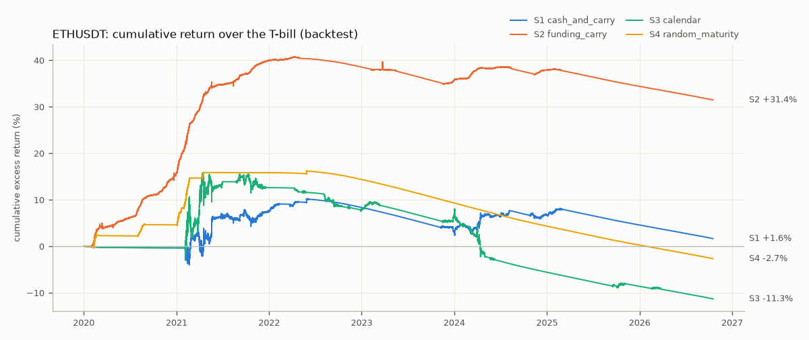
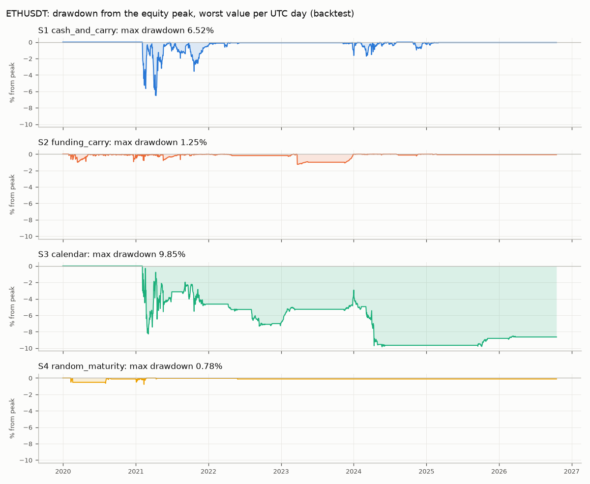
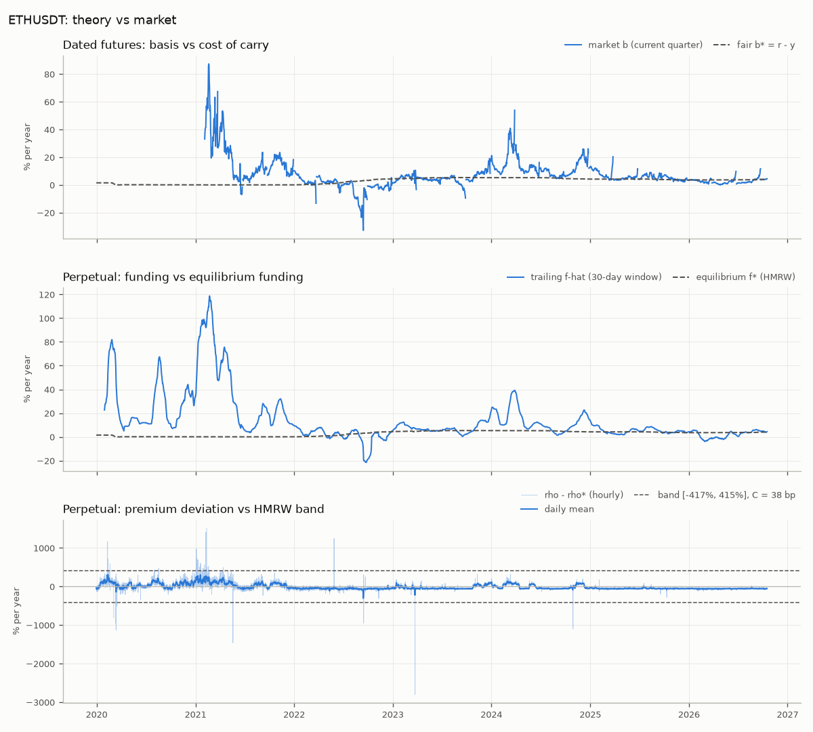

# Backtest report: ETHUSDT

Backtest (simulated taker fills on historical hourly bars), not paper or live results.
Sample 2020-01-01T00:00:00+00:00 to 2026-10-17T20:00:00+00:00 (59,565 hourly bars, 6.80 years), panel `data\panel_ETHUSDT_1h.parquet`.
Target size: 10,000 USDT per leg, equal coin quantity on both legs, resized to target when the pair notional drifts more than 25%. All figures are net of fees, slippage, delivery fees, liquidation penalties and resize costs.

## Headline (excess of the T-bill)

| Strategy | Excess ann. return | Excess Sharpe | Raw ann. return | Raw Sharpe | Max DD | Round trips | Hit rate | Avg hold (h) | Time in position | Turnover (x/yr) | Worst 30d | Liquidations | Resizes |
| --- | ---: | ---: | ---: | ---: | ---: | ---: | ---: | ---: | ---: | ---: | ---: | ---: | ---: |
| S1 cash_and_carry | 0.24% | 0.07 | 3.10% | 0.90 | 6.52% | 14 | 100% | 1,351 | 32% | 7.0 | -3.81% | 0 | 16 |
| S2 funding_carry | 4.63% | 4.03 | 7.49% | 6.73 | 1.25% | 4 | 100% | 7,756 | 52% | 3.8 | -0.52% | 0 | 43 |
| S3 calendar | -1.67% | -0.35 | 1.20% | 0.25 | 9.85% | 26 | 58% | 608 | 27% | 16.2 | -6.28% | 0 | 5 |
| S4 random_maturity | -0.40% | -0.44 | 2.47% | 2.81 | 0.78% | 10 | 100% | 190 | 3% | 4.0 | -0.12% | 0 | 3 |

Excess ann. return = total excess return / years, where the excess return deducts the T-bill rate (panel r_usd) on the capital in use, flat days included. Raw figures assume idle cash earns nothing. Worst 30d = worst rolling 30-day sum of daily raw returns. Turnover = traded notional / mean capital per year. Round trips exclude a position still open on the last bar.

## P&L decomposition (USDT, whole sample)

| Strategy | Target capital | Mean capital | Basis convergence | Funding | Fees + slippage | Delivery fees | Liquidation penalties | Resize costs | Total P&L | T-bill on capital | Excess P&L |
| --- | ---: | ---: | ---: | ---: | ---: | ---: | ---: | ---: | ---: | ---: | ---: |
| S1 cash_and_carry | 15,000 | 15,111 | 3,948.18 | 0.00 | -580.24 | 0.00 | 0.00 | -82.38 | 3,285.56 | -2,932.83 | 352.72 |
| S2 funding_carry | 15,000 | 15,110 | -77.07 | 8,620.31 | -144.77 | 0.00 | 0.00 | -224.17 | 8,174.30 | -2,917.82 | 5,256.48 |
| S3 calendar | 10,000 | 10,080 | -1,188.77 | 2,815.22 | -758.69 | 0.00 | 0.00 | -20.37 | 847.40 | -1,951.27 | -1,103.87 |
| S4 random_maturity | 15,000 | 15,024 | 609.42 | 2,473.27 | -376.17 | 0.00 | 0.00 | -15.48 | 2,691.04 | -2,918.78 | -227.75 |

## Margin

| Strategy | Margin mode | Leverage | Peak utilization (close) | Bars above isolated threshold | Intrabar breach bars (diagnostic) | Peak intrabar utilization | Peak pair utilization | Liquidations | Resizes |
| --- | ---: | ---: | ---: | ---: | ---: | ---: | ---: | ---: | ---: |
| S1 cash_and_carry | isolated | fut 2x | 0.615 | 0 | 0 | 0.627 | n/a | 0 | 16 |
| S2 funding_carry | isolated | perp 2x | 0.642 | 0 | 1 | 4.086 | n/a | 0 | 43 |
| S3 calendar | cross_collateral | perp 2x, fut 2x | 0.760 | 0 | 1 | 1.042 | 0.087 | 0 | 5 |
| S4 random_maturity | isolated | perp 2x | 0.626 | 0 | 0 | 0.698 | n/a | 0 | 3 |

Liquidation is decided on close prices; 'intrabar breach bars' counts bars whose high/low would have crossed the isolated threshold (diagnostic only, never triggers). Peak pair utilization = net loss of the two futures legs / their posted margin (S3).

## Year by year

Bars are labeled by close time, so the bar closing at 00:00 UTC on 1 January belongs to the previous year (a sample starting at 00:00 shows a one-bar row for that year). Returns are period sums (not annualized); round trips are counted in the year they close; costs = fees + slippage + delivery + liquidation + resize.

### S1 cash_and_carry

| Year | Days | P&L (USDT) | Return | Excess return | Raw Sharpe | Excess Sharpe | Max DD | Basis | Funding | Costs | Round trips | Time in position | Liquidations | Resizes |
| --- | ---: | ---: | ---: | ---: | ---: | ---: | ---: | ---: | ---: | ---: | ---: | ---: | ---: | ---: |
| 2019 | 1 | 0.00 | 0.00% | -0.00% | n/a | n/a | 0.00% | 0.00 | 0.00 | 0.00 | 0 | 0% | 0 | 0 |
| 2020 | 366 | 0.00 | 0.00% | -0.37% | 0.00 | -13.17 | 0.00% | 0.00 | 0.00 | 0.00 | 0 | 0% | 0 | 0 |
| 2021 | 365 | 1,305.61 | 7.98% | 7.93% | 0.98 | 0.98 | 6.52% | 1,620.97 | 0.00 | -315.36 | 6 | 87% | 0 | 10 |
| 2022 | 365 | 417.71 | 2.76% | 0.76% | 2.47 | 0.67 | 0.62% | 528.51 | 0.00 | -110.81 | 3 | 23% | 0 | 2 |
| 2023 | 365 | -29.83 | -0.22% | -5.28% | -0.26 | -6.27 | 0.99% | 29.31 | 0.00 | -59.14 | 1 | 14% | 0 | 0 |
| 2024 | 366 | 1,316.93 | 8.73% | 3.75% | 2.49 | 1.07 | 1.71% | 1,469.26 | 0.00 | -152.32 | 3 | 76% | 0 | 3 |
| 2025 | 365 | 275.15 | 1.84% | -2.23% | 2.79 | -3.38 | 0.38% | 300.13 | 0.00 | -24.98 | 1 | 17% | 0 | 1 |
| 2026 | 290 | 0.00 | 0.00% | -2.93% | 0.00 | -493.62 | 0.00% | 0.00 | 0.00 | 0.00 | 0 | 0% | 0 | 0 |

### S2 funding_carry

| Year | Days | P&L (USDT) | Return | Excess return | Raw Sharpe | Excess Sharpe | Max DD | Basis | Funding | Costs | Round trips | Time in position | Liquidations | Resizes |
| --- | ---: | ---: | ---: | ---: | ---: | ---: | ---: | ---: | ---: | ---: | ---: | ---: | ---: | ---: |
| 2019 | 1 | 0.00 | 0.00% | -0.00% | n/a | n/a | 0.00% | 0.00 | 0.00 | 0.00 | 0 | 0% | 0 | 0 |
| 2020 | 366 | 2,641.10 | 16.17% | 15.81% | 9.01 | 8.82 | 1.00% | -54.44 | 2,784.00 | -88.47 | 0 | 92% | 0 | 13 |
| 2021 | 365 | 3,890.27 | 24.17% | 24.13% | 13.44 | 13.41 | 0.79% | -42.18 | 4,035.81 | -103.36 | 0 | 100% | 0 | 20 |
| 2022 | 365 | 89.68 | 0.60% | -1.41% | 2.16 | -4.75 | 0.18% | 4.95 | 117.57 | -32.84 | 1 | 33% | 0 | 3 |
| 2023 | 365 | 378.74 | 2.24% | -2.82% | 5.83 | -7.32 | 1.25% | -3.81 | 442.56 | -60.00 | 1 | 39% | 0 | 1 |
| 2024 | 366 | 1,094.48 | 7.17% | 2.18% | 13.19 | 4.04 | 0.24% | 17.37 | 1,145.46 | -68.35 | 1 | 75% | 0 | 6 |
| 2025 | 365 | 80.03 | 0.56% | -3.51% | 3.25 | -20.64 | 0.07% | 1.04 | 94.92 | -15.93 | 1 | 15% | 0 | 0 |
| 2026 | 290 | 0.00 | 0.00% | -2.93% | 0.00 | -493.62 | 0.00% | 0.00 | 0.00 | 0.00 | 0 | 0% | 0 | 0 |

### S3 calendar

| Year | Days | P&L (USDT) | Return | Excess return | Raw Sharpe | Excess Sharpe | Max DD | Basis | Funding | Costs | Round trips | Time in position | Liquidations | Resizes |
| --- | ---: | ---: | ---: | ---: | ---: | ---: | ---: | ---: | ---: | ---: | ---: | ---: | ---: | ---: |
| 2019 | 1 | 0.00 | 0.00% | -0.00% | n/a | n/a | 0.00% | 0.00 | 0.00 | 0.00 | 0 | 0% | 0 | 0 |
| 2020 | 366 | 0.00 | 0.00% | -0.37% | 0.00 | -13.17 | 0.00% | 0.00 | 0.00 | 0.00 | 0 | 0% | 0 | 0 |
| 2021 | 365 | 1,323.09 | 13.01% | 12.96% | 1.16 | 1.16 | 8.28% | -836.49 | 2,478.25 | -318.67 | 10 | 68% | 0 | 4 |
| 2022 | 365 | -264.52 | -2.65% | -4.66% | -1.75 | -3.06 | 2.83% | 94.52 | -169.13 | -189.91 | 6 | 30% | 0 | 0 |
| 2023 | 365 | 416.76 | 3.92% | -1.14% | 3.09 | -0.90 | 0.54% | 89.11 | 389.23 | -61.58 | 2 | 31% | 0 | 1 |
| 2024 | 366 | -748.18 | -7.42% | -12.40% | -1.57 | -2.62 | 7.81% | -761.00 | 140.02 | -127.21 | 5 | 31% | 0 | 0 |
| 2025 | 365 | 100.32 | 1.04% | -3.03% | 1.52 | -4.43 | 0.48% | 188.31 | -35.61 | -52.39 | 2 | 11% | 0 | 0 |
| 2026 | 290 | 19.94 | 0.23% | -2.70% | 0.61 | -7.10 | 0.29% | 36.78 | 12.46 | -29.30 | 1 | 12% | 0 | 0 |

### S4 random_maturity

| Year | Days | P&L (USDT) | Return | Excess return | Raw Sharpe | Excess Sharpe | Max DD | Basis | Funding | Costs | Round trips | Time in position | Liquidations | Resizes |
| --- | ---: | ---: | ---: | ---: | ---: | ---: | ---: | ---: | ---: | ---: | ---: | ---: | ---: | ---: |
| 2019 | 1 | 0.00 | 0.00% | -0.00% | n/a | n/a | 0.00% | 0.00 | 0.00 | 0.00 | 0 | 0% | 0 | 0 |
| 2020 | 366 | 795.86 | 4.96% | 4.60% | 4.77 | 4.45 | 0.65% | 83.43 | 794.13 | -81.70 | 2 | 10% | 0 | 1 |
| 2021 | 365 | 1,812.87 | 11.26% | 11.21% | 6.10 | 6.08 | 0.78% | 406.45 | 1,678.12 | -271.70 | 7 | 11% | 0 | 2 |
| 2022 | 365 | 82.30 | 0.55% | -1.46% | 0.82 | -2.16 | 0.12% | 119.54 | 1.01 | -38.25 | 1 | 0% | 0 | 0 |
| 2023 | 365 | 0.00 | 0.00% | -5.06% | 0.00 | -333.31 | 0.00% | 0.00 | 0.00 | 0.00 | 0 | 0% | 0 | 0 |
| 2024 | 366 | 0.00 | 0.00% | -4.98% | 0.00 | -260.59 | 0.00% | 0.00 | 0.00 | 0.00 | 0 | 0% | 0 | 0 |
| 2025 | 365 | 0.00 | 0.00% | -4.07% | 0.00 | -351.29 | 0.00% | 0.00 | 0.00 | 0.00 | 0 | 0% | 0 | 0 |
| 2026 | 290 | 0.00 | 0.00% | -2.93% | 0.00 | -493.62 | 0.00% | 0.00 | 0.00 | 0.00 | 0 | 0% | 0 | 0 |

## Stress episodes

### S1 cash_and_carry

| Episode | Window (UTC days) | Coverage | Days | P&L (USDT) | Return | Excess return | Raw Sharpe | Excess Sharpe | Max DD | Basis | Funding | Costs | Round trips | Time in position | Liquidations | Resizes |
| --- | ---: | ---: | ---: | ---: | ---: | ---: | ---: | ---: | ---: | ---: | ---: | ---: | ---: | ---: | ---: | ---: |
| Mar-2020 | 2020-03-01 .. 2020-04-30 | 100% | 61 | 0.00 | 0.00% | -0.04% | 0.00 | -16.25 | 0.00% | 0.00 | 0.00 | 0.00 | 0 | 0% | 0 | 0 |
| May-2021 | 2021-05-01 .. 2021-08-15 | 100% | 107 | 612.56 | 3.88% | 3.86% | 1.97 | 1.96 | 2.32% | 784.34 | 0.00 | -171.77 | 4 | 88% | 0 | 5 |
| Nov-2022 FTX | 2022-11-01 .. 2022-12-31 | 100% | 61 | 0.00 | 0.00% | -0.70% | 0.00 | -977.36 | 0.00% | 0.00 | 0.00 | 0.00 | 0 | 0% | 0 | 0 |
| Aug-2024 | 2024-08-01 .. 2024-09-30 | 100% | 61 | 117.71 | 0.92% | 0.10% | 4.72 | 0.51 | 0.08% | 130.75 | 0.00 | -13.04 | 1 | 7% | 0 | 0 |
| Q1/Q2-2026 funding compression | 2026-01-31 .. 2026-05-31 | 100% | 121 | 0.00 | 0.00% | -1.19% | 0.00 | -5,465.84 | 0.00% | 0.00 | 0.00 | 0.00 | 0 | 0% | 0 | 0 |

### S2 funding_carry

| Episode | Window (UTC days) | Coverage | Days | P&L (USDT) | Return | Excess return | Raw Sharpe | Excess Sharpe | Max DD | Basis | Funding | Costs | Round trips | Time in position | Liquidations | Resizes |
| --- | ---: | ---: | ---: | ---: | ---: | ---: | ---: | ---: | ---: | ---: | ---: | ---: | ---: | ---: | ---: | ---: |
| Mar-2020 | 2020-03-01 .. 2020-04-30 | 100% | 61 | 103.99 | 0.68% | 0.64% | 1.39 | 1.31 | 1.00% | -37.99 | 169.03 | -27.05 | 0 | 100% | 0 | 5 |
| May-2021 | 2021-05-01 .. 2021-08-15 | 100% | 107 | 348.15 | 2.37% | 2.35% | 6.77 | 6.74 | 0.79% | -21.23 | 410.00 | -40.62 | 0 | 100% | 0 | 8 |
| Nov-2022 FTX | 2022-11-01 .. 2022-12-31 | 100% | 61 | 0.00 | 0.00% | -0.70% | 0.00 | -977.36 | 0.00% | 0.00 | 0.00 | 0.00 | 0 | 0% | 0 | 0 |
| Aug-2024 | 2024-08-01 .. 2024-09-30 | 100% | 61 | -20.66 | -0.14% | -0.96% | -2.37 | -15.94 | 0.12% | -0.10 | 3.22 | -23.78 | 1 | 21% | 0 | 1 |
| Q1/Q2-2026 funding compression | 2026-01-31 .. 2026-05-31 | 100% | 121 | 0.00 | 0.00% | -1.19% | 0.00 | -5,465.84 | 0.00% | 0.00 | 0.00 | 0.00 | 0 | 0% | 0 | 0 |

### S3 calendar

| Episode | Window (UTC days) | Coverage | Days | P&L (USDT) | Return | Excess return | Raw Sharpe | Excess Sharpe | Max DD | Basis | Funding | Costs | Round trips | Time in position | Liquidations | Resizes |
| --- | ---: | ---: | ---: | ---: | ---: | ---: | ---: | ---: | ---: | ---: | ---: | ---: | ---: | ---: | ---: | ---: |
| Mar-2020 | 2020-03-01 .. 2020-04-30 | 100% | 61 | 0.00 | 0.00% | -0.04% | 0.00 | -16.25 | 0.00% | 0.00 | 0.00 | 0.00 | 0 | 0% | 0 | 0 |
| May-2021 | 2021-05-01 .. 2021-08-15 | 100% | 107 | 53.61 | 1.42% | 1.41% | 1.06 | 1.05 | 4.73% | -125.67 | 287.28 | -107.99 | 4 | 50% | 0 | 2 |
| Nov-2022 FTX | 2022-11-01 .. 2022-12-31 | 100% | 61 | 27.90 | 0.28% | -0.42% | 1.52 | -2.34 | 0.56% | 81.68 | -11.86 | -41.92 | 1 | 19% | 0 | 0 |
| Aug-2024 | 2024-08-01 .. 2024-09-30 | 100% | 61 | 0.00 | 0.00% | -0.82% | 0.00 | -458.64 | 0.00% | 0.00 | 0.00 | 0.00 | 0 | 0% | 0 | 0 |
| Q1/Q2-2026 funding compression | 2026-01-31 .. 2026-05-31 | 100% | 121 | 19.94 | 0.23% | -0.96% | 0.94 | -3.92 | 0.29% | 36.78 | 12.46 | -29.30 | 1 | 29% | 0 | 0 |

### S4 random_maturity

| Episode | Window (UTC days) | Coverage | Days | P&L (USDT) | Return | Excess return | Raw Sharpe | Excess Sharpe | Max DD | Basis | Funding | Costs | Round trips | Time in position | Liquidations | Resizes |
| --- | ---: | ---: | ---: | ---: | ---: | ---: | ---: | ---: | ---: | ---: | ---: | ---: | ---: | ---: | ---: | ---: |
| Mar-2020 | 2020-03-01 .. 2020-04-30 | 100% | 61 | 0.00 | 0.00% | -0.04% | 0.00 | -16.25 | 0.00% | 0.00 | 0.00 | 0.00 | 0 | 0% | 0 | 0 |
| May-2021 | 2021-05-01 .. 2021-08-15 | 100% | 107 | 0.00 | 0.00% | -0.01% | 0.00 | -39.63 | 0.00% | 0.00 | 0.00 | 0.00 | 0 | 0% | 0 | 0 |
| Nov-2022 FTX | 2022-11-01 .. 2022-12-31 | 100% | 61 | 0.00 | 0.00% | -0.70% | 0.00 | -977.36 | 0.00% | 0.00 | 0.00 | 0.00 | 0 | 0% | 0 | 0 |
| Aug-2024 | 2024-08-01 .. 2024-09-30 | 100% | 61 | 0.00 | 0.00% | -0.82% | 0.00 | -458.64 | 0.00% | 0.00 | 0.00 | 0.00 | 0 | 0% | 0 | 0 |
| Q1/Q2-2026 funding compression | 2026-01-31 .. 2026-05-31 | 100% | 121 | 0.00 | 0.00% | -1.19% | 0.00 | -5,465.84 | 0.00% | 0.00 | 0.00 | 0.00 | 0 | 0% | 0 | 0 |

## Funding diagnostics

Share of funding prints exactly equal to 0.000100 (Binance's interest component: the average premium sat inside the clamp band) and the cadence of prints (hours since the previous print), by year of the print.

| Year | Funding prints | Share exactly 0.000100 | 1h gaps | 4h gaps | 8h gaps | Other gaps |
| --- | ---: | ---: | ---: | ---: | ---: | ---: |
| 2020 | 1098 | 56.8% | 0 | 0 | 1097 | 0 |
| 2021 | 1095 | 44.8% | 0 | 0 | 1095 | 0 |
| 2022 | 1095 | 25.8% | 0 | 0 | 1095 | 0 |
| 2023 | 1095 | 37.3% | 0 | 0 | 1095 | 0 |
| 2024 | 1098 | 39.6% | 0 | 0 | 1098 | 0 |
| 2025 | 1095 | 19.4% | 0 | 0 | 1095 | 0 |
| 2026 | 870 | 5.2% | 0 | 0 | 870 | 0 |

## Sensitivity grid

Mode `small`: **N_configs = 12** grid cells per strategy x 4 strategies, plus 3 HMRW replication cells for S4 and S2. Discount the best cell accordingly; the full grid is in `sensitivity.md` / `sensitivity.csv`.

| Strategy | Base excess Sharpe | Median | Min | Max | Base excess ann. return | Median | Min | Max | Cells with excess return > 0 |
| --- | ---: | ---: | ---: | ---: | ---: | ---: | ---: | ---: | ---: |
| S1 cash_and_carry | 0.07 | 0.07 | -0.22 | 0.17 | 0.24% | 0.24% | -0.60% | 0.65% | 8/12 |
| S2 funding_carry | 4.03 | 4.03 | 3.15 | 4.32 | 4.63% | 4.63% | 2.75% | 5.57% | 12/12 |
| S3 calendar | -0.35 | -0.36 | -0.95 | 0.12 | -1.67% | -1.68% | -2.26% | 0.57% | 1/12 |
| S4 random_maturity | -0.44 | -0.44 | -1.48 | 1.01 | -0.40% | -0.40% | -1.01% | 1.04% | 2/12 |

HMRW replication cells (HMRW's fee levels, no slippage; other settings pre-registered):

| Strategy | Costs | Excess ann. return | Excess Sharpe | Raw Sharpe | Round trips | Time in position | Liquidations |
| --- | --- | ---: | ---: | ---: | ---: | ---: | ---: |
| S2 funding_carry | VIP0 (base cell) | 4.63% | 4.03 | 6.73 | 4 | 52.1% | 0 |
| S2 funding_carry | HMRW-low | 5.23% | 4.56 | 7.29 | 6 | 57.2% | 0 |
| S2 funding_carry | HMRW-mid | 5.11% | 4.46 | 7.18 | 5 | 55.7% | 0 |
| S2 funding_carry | HMRW-high | 4.97% | 4.34 | 7.06 | 4 | 53.7% | 0 |
| S4 random_maturity | VIP0 (base cell) | -0.40% | -0.44 | 2.81 | 10 | 3.2% | 0 |
| S4 random_maturity | HMRW-low | 5.22% | 3.95 | 6.30 | 255 | 25.5% | 0 |
| S4 random_maturity | HMRW-mid | 4.29% | 3.25 | 5.57 | 103 | 18.9% | 0 |
| S4 random_maturity | HMRW-high | 3.28% | 2.84 | 5.49 | 59 | 13.5% | 0 |

## Figures

Cumulative sum of hourly excess returns (return on the capital in use minus the T-bill), net of all costs.

Drawdown from the running equity peak (raw P&L); one panel per strategy, worst value of each UTC day.

Top: annualized current-quarter basis b = ln(F/S)/tau vs the cost-of-carry fair basis b* = r - y (daily means; bars inside the 2-day roll window are masked because ln(F/S)/tau explodes as tau -> 0). Middle: trailing funding f-hat vs HMRW equilibrium funding f*. Bottom: HMRW premium deviation rho - rho* (hourly and daily mean) with the Prop. 2 no-arbitrage band; S4 enters when the hourly value is above the upper edge.

## Assumptions

### Configuration used

- Notional per leg: 10,000 USDT; costs: spot fee 10 bp, futures fee 5 bp, slippage 2 bp per leg, delivery fee 5 bp, liquidation penalty 50 bp.
- Margin: spot-leg strategies isolated, futures pair (S3) cross_collateral; perp leverage 2x, quarterly leverage 2x, maintenance 0.40%.
- Strategy parameters: {'cc_entry_buffer_ann': 0.03, 'cc_exit_excess_ann': 0.0, 'cc_roll_days': 2.0, 'cc_hold_to_expiry': False, 'fc_lookback_prints': 90, 'fc_entry_buffer_ann': 0.03, 'fc_exit_excess_ann': 0.0, 'fc_expected_hold_days': 30.0, 'cal_entry_buffer_ann': 0.03, 'cal_exit_excess_ann': 0.0, 'cal_roll_days': 2.0, 'cal_hold_to_expiry': False, 'cal_allow_reverse': True, 'rm_exit_dev_ann': 0.0, 'min_hold_bars': 8, 'fill_lag_bars': 0, 'allow_reverse': False}

### Engine implementation choices

- Headline = excess of the T-bill: the risk-free rate accrues hourly at r_usd/8760 on the previous bar's capital ((mean r of the day)/365 x capital for a full day), including flat days, because the capital is committed to the strategy. Raw figures (idle cash earns nothing) are reported second.
- Capital = capital actually required by the open position, re-measured each bar: spot value + futures notional / leverage (S3: both futures legs at their leverage); the target capital while flat. Hourly return = P&L / previous bar's capital; daily return = sum of hourly returns (no compounding).
- Equal coin quantity on both legs: qty = notional_per_leg / close of the first leg (spot for S1/S2/S4, perpetual for S3). Fills at close x (1 +/- slippage) with fees on the executed notional; the 'basis' component is marked at reference (close) prices, so slippage appears under fees.
- Bar order: mark, settle expiries, funding, margin monitor, trade, resize. Funding is paid to perp legs held before the bar's trades (a leg opened on a stamp bar does not receive that stamp; a leg closed on a stamp bar does). Decisions are filled fill_lag_bars bars later (0 pre-registered).
- Expiry: a held quarterly with expiry <= ts settles at spot_close with the delivery fee; the remaining leg is closed on the same bar at close +/- slippage (round trip exit_reason EXPIRY).
- Margin monitor on CLOSE prices: worst adverse close move since entry (or since the last resize). Isolated mode (S1/S2/S4 by default) liquidates a leg whose move exceeds 1/leverage - maintenance at that bar's close (+/- slippage, taker fee, liquidation penalty) and closes the other leg. S3 uses futures_pair_mode (cross_collateral: no per-leg liquidation). The intrabar high/low worst case never triggers; it is counted as a diagnostic. Utilization = adverse close move / (1/leverage - maintenance).
- Resize: at a funding stamp, if |pair notional / target - 1| > 25% (pair notional = |qty| x close of the first leg), both legs are traded back to the target notional at close +/- slippage with fees (P&L component 'resize'); the futures margin is re-established, so the margin monitor restarts.
- After a forced close (expiry or liquidation) the engine stays flat until the target's (direction, contract) pair changes; it never re-enters on the bar of the forced close.
- A roll closes the old quarterly and opens the next one (same coin quantity) on the same bar; the spot/perp leg is untouched and the round trip continues (contract column 'A>B').
- A futures leg without a price on a bar keeps its last mark (closing at it logs STALE_PRICE; a resize waits for a priced stamp); an entry or roll into an unpriced contract is skipped (NO_PRICE) and retried.
- Positions open on the last bar are marked to market without exit costs (trades exit_reason OPEN; excluded from round-trip counts and hit rate).
- Daily figures by UTC day; the bar closing at 00:00 UTC belongs to the previous day. Sharpe = mean/std x sqrt(365) of daily returns; an identically zero series has Sharpe 0. Max drawdown is a fraction of the running equity peak.

### Pre-registered spec excerpt (docs/strategy_spec.md, sections 4, 6 and 7, verbatim)

#### 4. Costs and hurdles

Per-leg cost = fee + slippage, in bp of leg notional: spot 10 + 2, futures 5 + 2 (Binance VIP0, taker,
no BNB discount). Round trip for a two-leg position = 2 × (leg₁ + leg₂):

| Pair | Round trip `C` |
|---|---|
| spot + futures (S1, S2, S4) | 38 bp |
| perp + quarterly (S3) | 28 bp |

Hurdle (annualized) = `C × 365 / H + buffer`, where `H` is the expected holding horizon in days and
`buffer = 3%/yr`:

* S1/S3: `H = days to expiry` of the contract considered (the hurdle rises mechanically as expiry nears).
* S2: `H = 30` days (fixed, matches the trailing-funding lookback).
* S4: the hurdle is HMRW's band edge `κ·ln(1 + C)` (a one-off cost expressed in annualized-premium units); no buffer.
  At VIP0 taker costs this is 4.15 in annualized-premium units, i.e. a 38 bp perpetual premium at an hourly
  close, about 2.3× HMRW's widest tested band, so S4 is expected to be nearly inactive at VIP0; the HMRW fee
  levels are run as replication cells (§8).

Delivery fee 5 bp on a quarterly carried into settlement. Liquidation penalty 50 bp (isolated mode only).
Cost tiers for the grid: VIP0 (10 / 5 / 2 bp), VIP0 with BNB discount (spot −25%, futures −10%: 7.5 / 4.5 / 2),
VIP3 (6 / 3.2 / 2); HMRW replication (2.25 / 0.18, 4.5 / 0.72, 6.75 / 1.44 bp, no slippage).

#### 6. Backtest engine semantics (backtest/engine.py)

Event loop over the 1h panel, one strategy at a time, equal coin quantity on both legs:

1. **Mark**: equity = cash + spot_qty × spot_close + Σ fut_qty × (close − entry_price).
2. **Settle expiries**: a held quarterly with `expiry <= ts` settles at `spot_close` of that bar (proxy for
   Binance's index average over the final 30 minutes) and pays the delivery fee, regardless of the target.
3. **Funding**: at a funding stamp, perp positions held *before* this bar's trades receive
   `−qty × funding_rate × perp_close` (a short with positive funding receives cash). Positions opened at
   the stamp bar do not receive that stamp's funding.
4. **Margin monitor** (futures legs): track the worst adverse **close** move since entry (Binance liquidates
   on mark price; last-trade wicks on thin quarterlies are not mark prices, so the intrabar high/low worst case
   is reported as a diagnostic only). Spot-leg strategies (S1, S2, S4) use isolated mode: if the adverse move
   exceeds `1/leverage − maintenance` the leg is liquidated at that bar's close, the other leg is closed, the
   penalty is charged, and the event is logged. S3's two futures legs share one USDⓈ-M wallet
   (`futures_pair_mode = cross_collateral`): no per-leg liquidation; peak utilization is reported.
5. **Trade**: if `target` or `contract` changed, close/open legs at `close ± slippage` and pay fees, at the
   decision bar (`fill_lag_bars = 0`, pre-registered) or the next bar (`fill_lag_bars = 1`, sensitivity axis).
   A roll closes the old contract and opens the new one on the same bar; the spot leg is untouched.
6. **Resize**: at a funding stamp, if the pair's notional deviates from the target by more than 25%, both legs
   are resized to the target notional (fees charged, event logged), so exposure never drifts far from capital.
7. **Capital** for return computation is the capital actually required by the open position, re-measured each
   bar: spot-leg strategies `spot value + futures margin at target leverage`; futures-only (S3)
   `2 × notional / leverage`. Idle cash earns nothing in the raw figures; the headline figures are excess of
   the T-bill (§7).

P&L decomposition per strategy: basis convergence (mark-to-market of the two legs), funding received or
paid, fees + slippage, delivery fees, liquidation penalties, resize costs.

#### 7. Metrics (backtest/metrics.py)

* Daily aggregation of P&L (UTC days). **Headline figures are excess of the risk-free rate**: daily excess
  P&L = P&L − (r_t/365) × capital, Sharpe = mean/std × √365 (24/7 market) on the excess series, net of all
  costs. Raw (non-excess) figures are reported second, never as the headline.
* Annualized excess return on capital, max drawdown (on equity), hit rate per round trip, average holding time,
  number of round trips, turnover, time-in-position, worst 30-day window, liquidation and resize counts,
  peak margin utilization, intrabar worst-case diagnostic, share of funding prints exactly equal to 0.01% by year.
* Year-by-year table and the five stress episodes named in the research log (Mar-2020, May-2021,
  Nov-2022 FTX, Aug-2024, Q1/Q2-2026 funding compression).
* "Theory vs market" diagnostics: time series of `b` vs `b*`, `f̂` vs `f*`, `ρ` vs `ρ*`, with the band.
