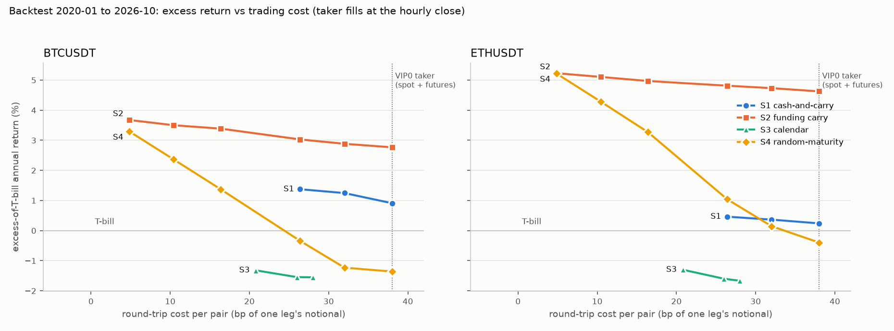

# Cost and latency diagnostics

Backtest diagnostics, not paper or live results. No rule, threshold or cost assumption was changed: every
cell below is a cell of the sanctioned sensitivity grid (`docs/strategy_spec.md` section 8) or one of its
HMRW replication cells, so `N_configs` is unchanged (12 grid cells per strategy + 3 replication cells for
S2 and S4). Generated by `scripts/cost_latency_report.py` on the engine and model code of commit
`3de9e4f`; full-sample cell metrics are read from `reports/{ROOT}/sensitivity.csv` (commit `36f7433`).

**Read the fee cells correctly.** The cost-tier and HMRW cells lower the fees but keep the same execution
model: taker fills at the hourly close (HMRW cells without slippage). They are not maker fills. A liquidity
provider earning these fee levels with resting quotes also faces fill uncertainty, queue position and
adverse selection, none of which this backtest measures.

## 1. Excess return against round-trip cost (full sample 2020-01-01 to 2026-10-17)

Round-trip cost = 2 x (fee + slippage) on both legs, in bp of one leg's notional (spec section 4). Only the
cost axis varies; every other axis is at the pre-registered value.

| root | strategy | costs | round trip (bp) | excess ann. return | excess Sharpe | round trips |  |
| --- | --- | --- | --- | --- | --- | --- | --- |
| BTCUSDT | S1 cash-and-carry | VIP3 | 26.4 | 1.37% | 0.38 | 17 |  |
| BTCUSDT | S1 cash-and-carry | VIP0_BNB | 32.0 | 1.25% | 0.35 | 15 |  |
| BTCUSDT | S1 cash-and-carry | VIP0 | 38.0 | 0.91% | 0.26 | 12 | **base** |
| BTCUSDT | S2 funding carry | HMRW-low | 4.9 | 3.67% | 4.22 | 9 |  |
| BTCUSDT | S2 funding carry | HMRW-mid | 10.4 | 3.50% | 4.01 | 8 |  |
| BTCUSDT | S2 funding carry | HMRW-high | 16.4 | 3.39% | 3.87 | 8 |  |
| BTCUSDT | S2 funding carry | VIP3 | 26.4 | 3.03% | 3.44 | 6 |  |
| BTCUSDT | S2 funding carry | VIP0_BNB | 32.0 | 2.88% | 3.28 | 5 |  |
| BTCUSDT | S2 funding carry | VIP0 | 38.0 | 2.77% | 3.14 | 5 | **base** |
| BTCUSDT | S3 calendar | VIP3 | 20.8 | -1.32% | -0.32 | 40 |  |
| BTCUSDT | S3 calendar | VIP0_BNB | 26.0 | -1.55% | -0.37 | 36 |  |
| BTCUSDT | S3 calendar | VIP0 | 28.0 | -1.55% | -0.37 | 36 | **base** |
| BTCUSDT | S4 random-maturity | HMRW-low | 4.9 | 3.29% | 3.66 | 157 |  |
| BTCUSDT | S4 random-maturity | HMRW-mid | 10.4 | 2.36% | 2.74 | 80 |  |
| BTCUSDT | S4 random-maturity | HMRW-high | 16.4 | 1.37% | 1.68 | 39 |  |
| BTCUSDT | S4 random-maturity | VIP3 | 26.4 | -0.34% | -0.48 | 18 |  |
| BTCUSDT | S4 random-maturity | VIP0_BNB | 32.0 | -1.23% | -1.95 | 9 |  |
| BTCUSDT | S4 random-maturity | VIP0 | 38.0 | -1.36% | -2.24 | 8 | **base** |
| ETHUSDT | S1 cash-and-carry | VIP3 | 26.4 | 0.46% | 0.13 | 15 |  |
| ETHUSDT | S1 cash-and-carry | VIP0_BNB | 32.0 | 0.37% | 0.11 | 15 |  |
| ETHUSDT | S1 cash-and-carry | VIP0 | 38.0 | 0.24% | 0.07 | 14 | **base** |
| ETHUSDT | S2 funding carry | HMRW-low | 4.9 | 5.23% | 4.56 | 6 |  |
| ETHUSDT | S2 funding carry | HMRW-mid | 10.4 | 5.11% | 4.46 | 5 |  |
| ETHUSDT | S2 funding carry | HMRW-high | 16.4 | 4.97% | 4.34 | 4 |  |
| ETHUSDT | S2 funding carry | VIP3 | 26.4 | 4.81% | 4.20 | 4 |  |
| ETHUSDT | S2 funding carry | VIP0_BNB | 32.0 | 4.73% | 4.13 | 4 |  |
| ETHUSDT | S2 funding carry | VIP0 | 38.0 | 4.63% | 4.03 | 4 | **base** |
| ETHUSDT | S3 calendar | VIP3 | 20.8 | -1.30% | -0.27 | 32 |  |
| ETHUSDT | S3 calendar | VIP0_BNB | 26.0 | -1.60% | -0.34 | 27 |  |
| ETHUSDT | S3 calendar | VIP0 | 28.0 | -1.67% | -0.35 | 26 | **base** |
| ETHUSDT | S4 random-maturity | HMRW-low | 4.9 | 5.22% | 3.95 | 255 |  |
| ETHUSDT | S4 random-maturity | HMRW-mid | 10.4 | 4.29% | 3.25 | 103 |  |
| ETHUSDT | S4 random-maturity | HMRW-high | 16.4 | 3.28% | 2.84 | 59 |  |
| ETHUSDT | S4 random-maturity | VIP3 | 26.4 | 1.04% | 1.01 | 27 |  |
| ETHUSDT | S4 random-maturity | VIP0_BNB | 32.0 | 0.15% | 0.15 | 16 |  |
| ETHUSDT | S4 random-maturity | VIP0 | 38.0 | -0.40% | -0.44 | 10 | **base** |

## 2. One-bar fill lag (full sample)

Same decisions, filled one hourly bar later (`fill_lag_bars = 1`), against the pre-registered cell.

| root | strategy | lag 0 (pre-registered) | lag 1 bar | change (pp) |
| --- | --- | --- | --- | --- |
| BTCUSDT | S1 cash-and-carry | 0.91% | -0.65% | -1.56 |
| BTCUSDT | S2 funding carry | 2.77% | 2.78% | +0.02 |
| BTCUSDT | S3 calendar | -1.55% | -2.85% | -1.30 |
| BTCUSDT | S4 random-maturity | -1.36% | -1.52% | -0.16 |
| ETHUSDT | S1 cash-and-carry | 0.24% | -0.60% | -0.84 |
| ETHUSDT | S2 funding carry | 4.63% | 4.63% | +0.00 |
| ETHUSDT | S3 calendar | -1.67% | -2.25% | -0.58 |
| ETHUSDT | S4 random-maturity | -0.40% | -0.85% | -0.45 |

## 3. S1 fill-lag gap per round trip

Pre-registered cell vs the same cell with one-bar fill lag; `diff` = lagged minus same-bar P&L (USDT,
10,000 USDT per leg). The basis moves are the one-hour change of ln(F/S) in bp from the decision bar
to the next bar, on the contract entered (entry) and the contract held at exit (exit).

### BTCUSDT

Total lag gap -1,650 USDT over 12 round trips; the three largest trips contribute -1,744 USDT and the other 9 trips +94 USDT. Median absolute one-hour basis move at the decision bars: 13.2 bp (round-trip cost at VIP0: 38 bp).

| entry | exit | contract | pnl lag 0 | pnl lag 1 | diff | entry 1h basis move (bp) | exit 1h basis move (bp) |
| --- | --- | --- | --- | --- | --- | --- | --- |
| 2021-02-03 09:00 | 2021-03-23 07:00 | BTCUSDT_210326 | 713.3 | -323.4 | -1,036.7 | -979.7 | 9.8 |
| 2021-03-24 09:00 | 2021-04-18 04:00 | BTCUSDT_210625 | 734.9 | 303.5 | -431.5 | -18.1 | 417.7 |
| 2021-04-18 05:00 | 2021-05-19 13:00 | BTCUSDT_210625 | 425.4 | 620.3 | 194.9 | 138.1 | -55.4 |
| 2021-05-19 15:00 | 2021-06-05 16:00 | BTCUSDT_210625 | 74.5 | 75.9 | 1.4 | 2.8 | 1.5 |
| 2021-06-10 02:00 | 2021-06-13 06:00 | BTCUSDT_210625 | 17.0 | 29.4 | 12.4 | -9.3 | -22.9 |
| 2021-06-23 09:00 | 2021-09-07 15:00 | BTCUSDT_210924 | 298.3 | 22.7 | -275.6 | 11.9 | 262.3 |
| 2021-09-22 09:00 | 2022-02-24 06:00 | BTCUSDT_211231>BTCUSDT_220325 | 311.1 | 286.0 | -25.1 | -9.5 | 16.8 |
| 2022-03-23 09:00 | 2022-05-10 01:00 | BTCUSDT_220624 | 102.6 | 71.6 | -31.0 | -14.6 | 15.7 |
| 2023-11-01 21:00 | 2024-03-25 13:00 | BTCUSDT_231229>BTCUSDT_240329 | 288.6 | 260.5 | -28.2 | -28.3 | 4.0 |
| 2024-03-27 09:00 | 2024-06-18 15:00 | BTCUSDT_240628 | 572.7 | 568.2 | -4.5 | 0.8 | 6.0 |
| 2024-06-26 09:00 | 2024-08-05 07:00 | BTCUSDT_240927 | 211.1 | 193.1 | -18.0 | -4.3 | 13.6 |
| 2024-10-15 00:00 | 2025-03-05 22:00 | BTCUSDT_241227>BTCUSDT_250328 | 327.8 | 319.7 | -8.2 | 5.2 | 12.7 |

### ETHUSDT

Total lag gap -770 USDT over 14 round trips; the three largest trips contribute -401 USDT and the other 11 trips -369 USDT. Median absolute one-hour basis move at the decision bars: 13.0 bp (round-trip cost at VIP0: 38 bp).

| entry | exit | contract | pnl lag 0 | pnl lag 1 | diff | entry 1h basis move (bp) | exit 1h basis move (bp) |
| --- | --- | --- | --- | --- | --- | --- | --- |
| 2021-02-04 08:00 | 2021-05-19 13:00 | ETHUSDT_210326>ETHUSDT_210625 | 973.3 | 825.3 | -148.1 | 78.2 | 357.5 |
| 2021-05-19 15:00 | 2021-05-21 15:00 | ETHUSDT_210625 | 36.9 | -43.8 | -80.7 | -30.9 | 57.8 |
| 2021-05-21 17:00 | 2021-06-08 14:00 | ETHUSDT_210625 | 38.6 | 11.1 | -27.5 | -19.5 | 8.8 |
| 2021-06-15 02:00 | 2021-06-16 17:00 | ETHUSDT_210625 | 23.4 | -2.6 | -26.1 | -13.6 | 13.0 |
| 2021-06-23 09:00 | 2021-09-07 15:00 | ETHUSDT_210924 | 78.9 | -32.2 | -111.1 | -0.2 | 128.3 |
| 2021-09-07 16:00 | 2021-09-21 10:00 | ETHUSDT_210924 | 27.9 | 10.0 | -17.9 | -11.8 | 7.4 |
| 2021-09-22 09:00 | 2022-02-09 23:00 | ETHUSDT_211231>ETHUSDT_220325 | 346.2 | 289.2 | -57.0 | -64.3 | 3.6 |
| 2022-03-23 09:00 | 2022-04-25 16:00 | ETHUSDT_220624 | 94.2 | 90.0 | -4.2 | 2.5 | 6.3 |
| 2022-05-28 17:00 | 2022-06-06 21:00 | ETHUSDT_220624 | 103.9 | -37.7 | -141.6 | -126.8 | 13.0 |
| 2023-11-09 16:00 | 2023-12-27 01:00 | ETHUSDT_231229 | 113.3 | 94.8 | -18.5 | -17.1 | 0.8 |
| 2023-12-27 09:00 | 2024-06-18 15:00 | ETHUSDT_240329>ETHUSDT_240628 | 775.6 | 779.9 | 4.4 | 3.5 | 16.9 |
| 2024-06-26 09:00 | 2024-08-05 02:00 | ETHUSDT_240927 | 234.9 | 219.2 | -15.7 | 0.2 | 22.3 |
| 2024-10-25 16:00 | 2024-10-28 22:00 | ETHUSDT_241227 | 64.2 | -37.2 | -101.4 | -7.5 | 90.8 |
| 2024-10-29 02:00 | 2025-03-02 19:00 | ETHUSDT_241227>ETHUSDT_250328 | 374.2 | 349.9 | -24.3 | 3.2 | 7.1 |

## 4. Calendar year 2026 (year to date, 290 days) of every sanctioned cell

Full-sample runs of each cell, sliced to the year (a position entered earlier is carried in). Returns are
period sums, not annualized; excess deducts the T-bill on committed capital, flat days included.
Per-cell rows: `year_2026_cells.csv`.

| root | strategy | cells | N | base return | base excess | best return | best excess | cells with excess > 0 | max entries in year |
| --- | --- | --- | --- | --- | --- | --- | --- | --- | --- |
| BTCUSDT | S1 cash-and-carry | grid | 12 | 0.00% | -2.93% | 0.25% | -2.68% | 0/12 | 0 |
| BTCUSDT | S2 funding carry | grid | 12 | 0.00% | -2.93% | 0.00% | -2.93% | 0/12 | 0 |
| BTCUSDT | S2 funding carry | HMRW replication | 3 |  |  | 0.33% | -2.60% | 0/3 | 1 |
| BTCUSDT | S3 calendar | grid | 12 | -0.47% | -3.41% | 0.53% | -2.40% | 0/12 | 6 |
| BTCUSDT | S4 random-maturity | grid | 12 | 0.00% | -2.93% | 0.00% | -2.93% | 0/12 | 0 |
| BTCUSDT | S4 random-maturity | HMRW replication | 3 |  |  | 0.00% | -2.93% | 0/3 | 0 |
| ETHUSDT | S1 cash-and-carry | grid | 12 | 0.00% | -2.93% | 0.00% | -2.93% | 0/12 | 0 |
| ETHUSDT | S2 funding carry | grid | 12 | 0.00% | -2.93% | 0.00% | -2.93% | 0/12 | 0 |
| ETHUSDT | S2 funding carry | HMRW replication | 3 |  |  | 0.00% | -2.93% | 0/3 | 0 |
| ETHUSDT | S3 calendar | grid | 12 | 0.23% | -2.70% | 0.94% | -1.99% | 0/12 | 5 |
| ETHUSDT | S4 random-maturity | grid | 12 | 0.00% | -2.93% | 0.00% | -2.93% | 0/12 | 0 |
| ETHUSDT | S4 random-maturity | HMRW replication | 3 |  |  | 0.00% | -2.93% | 0/3 | 0 |
